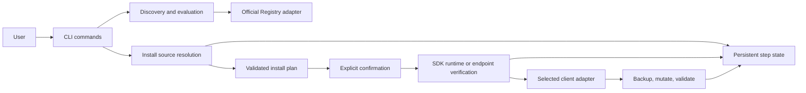

# Technical architecture

## Overall architecture

MCPGet is a Node.js CLI with separate discovery/evaluation and install/configuration flows. Install resolves a Registry or user-supplied source, confirms the action, checks MCP connectivity, configures one selected client, and persists independent step states. The official MCP TypeScript client SDK handles current protocol negotiation and supported transports.

## Current implementation boundary

- `install <server> <client>` accepts Registry identifiers, a unique friendly-name result, explicit `npm:`, `pypi:`, or `oci:` package references, and HTTPS remote endpoints. Ambiguous friendly-name matches are not selected automatically.
- npm package plans require interactive confirmation, install under an isolated MCPGet-owned user data directory, resolve the package's declared executable, verify that managed executable through MCP initialization, and point the selected client directly at it. The package version, location, associated clients/config entries, and verification status are recorded without credentials. Python and OCI execution remains explicitly opt-in and ephemeral.
- Claude support is limited to its local stdio JSON config. Remote connectors are managed through Claude settings.
- Claude and Cursor JSON adapters preserve unrelated root values and server entries, back up before writes, re-read the selected file, and compare the expected launch fields (command/args/env or endpoint). On Windows Claude uses its unique active `Claude-Data` profile when available, with an explicit override for multiple profiles and a legacy `%APPDATA%\Claude\claude_desktop_config.json` fallback. Cursor uses `~/.cursor/mcp.json`.
- Codex uses its user scope at `$CODEX_HOME/config.toml` (default `~/.codex/config.toml`). MCPGet reads, writes, removes, and verifies supported MCP server tables directly from TOML; the Codex CLI is used only for optional Codex CLI OAuth login. Required stdio environment values are written into the generated TOML server table. Project `.codex/config.toml` is not modified.
- `configured` means the persisted entry was re-read and matched. It does not mean the selected client application has loaded or connected to it. MCPGet records that client-level check as not verified until the app is independently observed.
- Known required local environment inputs are prompted for during installation. Secret input is hidden; supplied values are stored only in the selected client's configuration, which may be plaintext. Backups are permission-restricted and MCPGet installation metadata excludes values. Skipped required inputs leave setup pending and defer startup/connection verification. OAuth stays client/server-managed; a successful MCP initialization or client login command does not independently verify service authentication.
- `list` reads configured entries and their last recorded state. `doctor` validates configuration syntax and runtime executable availability; it does not rerun MCP connections.
- Install records in `~/.mcpget/installations.json` distinguish resolution, confirmation, execution registration, config, auth, startup, and connection outcomes. Records contain no credentials.
- Configuration presence does not prove the desktop client is installed. Publisher trust and runtime compatibility are not established by Registry metadata.

## Component responsibilities

- **CLI:** parse arguments, present evidence and prompts, map errors to actionable messages.
- **Use case orchestration:** sequence work without owning registry, client, or trust policy details.
- **Discovery engine:** query configured discovery sources and normalize candidates with provenance.
- **Domain resolver:** normalize a supplied URL and identify its registrable domain using a vetted approach; exact behavior needs design and tests.
- **Trust engine:** expose evidence, provenance, freshness, and uncertainty as explainable classifications.
- **Compatibility engine:** compare server requirements with client adapter capabilities.
- **Installation orchestrator:** plan and apply only user-approved changes through adapters.
- **Config/auth/verification:** isolate configuration IO, credential flows, and post-setup checks.

## Discovery engine and Official MCP Registry

The engine depends on a registry interface and currently uses the Official MCP Registry adapter. Its documented API assumptions and known discovery limits are in [registry research](../research/REGISTRY_DISCOVERY.md).

## Domain resolver

The resolver should normalize URL scheme, host, internationalized names, ports, and paths carefully; reject malformed or non-public destinations according to a documented policy; and avoid treating string suffixes as proof of ownership. Domain association is a discovery hint, not publisher verification.

## Trust engine

Trust output should be explainable and multi-dimensional. Preserve source links, timestamps, verification method, and unknown states. Do not convert absence of negative reports into proof of safety or call a publisher official without evidence.

## Compatibility and client adapters

Adapters should describe supported transports, authentication mechanisms, configuration capabilities, and safe read/write operations only where verified. Capability claims must cite current platform documentation. Platform details remain incomplete in [the research matrix](../research/PLATFORM_COMPATIBILITY.md).

## Installation orchestrator

Generate a preview before mutation, identify affected files, preserve unrelated settings, make recoverable backups, and require explicit confirmation. Keep write operations behind client adapters and make failure/rollback behavior explicit.

## Authentication

Authentication should be a separate flow with least privilege, no credential logging, and storage selected according to platform conventions after research. Do not assume a client's OAuth or secret storage behavior.

## Configuration management

Read and write through client-specific adapters. JSON adapters preserve unrelated keys, create a backup, perform atomic replacement, validate the resulting file, and independently verify the exact expected launch fields from disk. Codex uses a TOML parser to preserve unrelated user configuration, backs up before atomic replacement, and independently re-reads the written server entry. Concurrent-edit locking is not implemented.

## Connection verification

The official SDK verifies local process startup and MCP negotiation or remote MCP negotiation over Streamable HTTP with SSE fallback. Calls are bounded; process/transport cleanup runs on completion or timeout. An auth challenge is reported separately. MCP initialization does not prove a SaaS API credential works, and authenticated client-side state cannot currently be independently inspected.

## Security considerations

Treat registry metadata, package instructions, endpoints, and server responses as untrusted. Risks include malicious package execution, endpoint impersonation, SSRF, credential theft, configuration corruption, and misleading identity claims. Apply the security model in `../development/SECURITY_MODEL.md`.

## Error handling

Use typed internal errors with safe user-facing messages and actionable recovery hints. Separate invalid input, unavailable discovery sources, unverified candidates, incompatibility, permission failures, cancellation, and partial writes. Never include credentials or secret-bearing URLs in logs. Retry only bounded transient failures and preserve original errors for local debugging after redaction.
